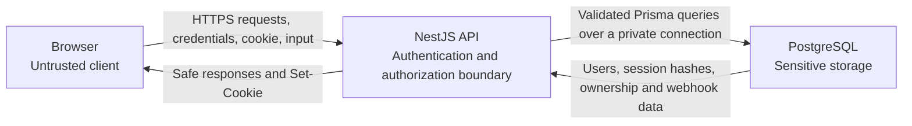

# Authentication Threat Model

## Scope

This document defines security invariants for registration, login, logout, current-session loading, and authorization of owned Webhook Center resources. It guides issues #12–#14 and must be reviewed when those endpoints and screens are implemented.

OAuth, email verification, password recovery, MFA, and a multi-device session management UI are out of scope. Production is assumed to use HTTPS; local HTTP development is an explicitly different environment.

## Trust boundaries



- The browser is untrusted. Client validation improves UX but never grants access.
- The API validates input, authenticates sessions, derives the current `userId`, and enforces resource ownership.
- PostgreSQL is reachable by the API, not directly by the browser. Database credentials stay in environment configuration and out of source control and logs.
- A stolen database is treated as a separate attacker capability; database contents are not assumed secret after compromise.

## Assets

- Plaintext passwords while they are being submitted.
- Password hashes and user email addresses.
- Raw session tokens in browser cookies and session-token hashes in PostgreSQL.
- User identity and ownership relationships for endpoints, events, and replay attempts.
- Endpoint capture tokens.
- Captured webhook headers, query strings, and raw bodies, which may contain third-party secrets or personal data.
- PostgreSQL credentials and application security configuration.

## Attackers

- An unauthenticated remote attacker probing registration and login.
- A malicious authenticated user attempting to access another user's resources.
- A malicious website attempting cross-site requests through the victim's browser.
- An attacker who steals an active session cookie.
- An attacker who obtains a PostgreSQL dump.
- Automated bots performing email enumeration, brute force, password spraying, or credential stuffing.
- An attacker who can inject JavaScript through a future XSS flaw.

## Threats and mitigations

| Threat                                          | Impact                                                                      | Decision, mitigation, or limitation                                                                                                                                                                                                                                |
| ----------------------------------------------- | --------------------------------------------------------------------------- | ------------------------------------------------------------------------------------------------------------------------------------------------------------------------------------------------------------------------------------------------------------------ |
| Plaintext or fast-hashed passwords              | Database theft immediately exposes credentials or makes guessing cheap      | Never store or log plaintext passwords. Hash with Argon2id and a unique library-managed salt. Start with 19 MiB memory, 2 iterations, and parallelism 1; benchmark and increase the cost when practical.                                                           |
| Excessively long password input                 | Expensive Argon2 work can consume API resources                             | Accept 15–128 characters, do not silently truncate, allow spaces and Unicode, and validate length before hashing. Rate-limit registration and login.                                                                                                               |
| Session-token disclosure from a stolen database | Attacker impersonates users                                                 | Generate at least 256 random bits with a cryptographically secure generator. Send the raw token only in the cookie and store only a cryptographic hash in `Session.tokenHash`. Never log either value.                                                             |
| Stolen active cookie                            | Attacker acts as the victim until revocation or expiry                      | Use `HttpOnly`, `Secure` in production, `SameSite=Lax`, `Path=/`, no `Domain`, seven-day absolute expiry, token rotation at login, and revocation at logout. Residual risk remains until expiry or revocation.                                                     |
| Session fixation                                | Attacker supplies a token that becomes authenticated                        | Accept only tokens generated by the API. On successful login, revoke any session represented by the incoming browser cookie and issue a fresh token. Never promote or reuse a client-provided token.                                                               |
| Expired or revoked session reuse                | Continued access after logout or expiry                                     | On every protected request, require a known session with `revokedAt IS NULL` and `expiresAt > now`. Clear invalid cookies. Cleanup may delete expired and revoked rows later, but rejection never depends on cleanup.                                              |
| Cross-site request forgery                      | Malicious site changes endpoints or account state using the victim's cookie | Keep every `GET` read-only. For cookie-authenticated `POST`, `PUT`, `PATCH`, and `DELETE`, require an exact approved `Origin`; reject missing, `null`, or mismatched origins. Use an exact credentialed CORS allowlist, never `*`. `SameSite` is defense in depth. |
| XSS attempts to steal a session                 | Token theft or authenticated actions                                        | `HttpOnly` blocks JavaScript from reading the cookie. React must keep escaping untrusted content, avoid unsafe HTML injection, and later add CSP. `HttpOnly` does not stop injected code from sending requests, so XSS remains a residual risk.                    |
| Login account enumeration                       | Attacker discovers registered email addresses                               | Return the same status and `Invalid email or password.` message for missing users and wrong passwords. Perform a comparable password-hash path and apply rate limiting and monitoring.                                                                             |
| Registration account enumeration                | Attacker discovers whether an email is registered                           | Accepted UX trade-off: return `An account with this email already exists. Sign in.` Apply registration rate limits and monitor repeated probes. Login remains generic.                                                                                             |
| Brute force and credential stuffing             | Account takeover and resource exhaustion                                    | Rate-limit by source and account identifier, log failures without credentials, avoid permanent attacker-triggered lockout, and consider stronger controls in the later hardening pass.                                                                             |
| IDOR or forged `userId`                         | Authenticated user reads or changes another user's resources                | Ignore ownership identifiers supplied by the browser. Derive `userId` from the validated session and query resources using both resource identity and owner identity. Return the same not-found response for missing and foreign resources.                        |
| Guessing a capture token                        | Unauthorized webhook injection and storage consumption                      | Generate a high-entropy, non-sequential capture token. Apply request-size and rate limits in capture-route work. A capture token grants submission, never access to account data.                                                                                  |
| Sensitive values in logs or API responses       | Credentials, tokens, hashes, or webhook secrets leak outside their boundary | Redact passwords, `Cookie`, token values, `passwordHash`, and `tokenHash`. Return public user fields only. Use stable generic server errors and internal request identifiers.                                                                                      |
| Stolen database exposes captured webhooks       | Headers and bodies may contain readable secrets                             | Accepted MVP limitation because exact request preservation is a core feature. Limit database/network access, protect backups, never copy payloads into auth logs, and evaluate encryption at rest before production use.                                           |

## Session lifecycle

1. Registration trims surrounding email whitespace and lowercases the address as the application's canonical comparison policy; it performs no provider-specific rewriting. It validates the 15–128 character password without trimming or normalizing it, hashes it with Argon2id, and creates one user. Registration does not automatically log the user in.
2. Login always follows a comparable password-verification path. A successful login creates a fresh, unpredictable token; a supplied token is never accepted as the new session ID.
3. The API stores only the token hash with `userId`, `createdAt`, and `expiresAt = createdAt + 7 days`. The raw token is returned only through `Set-Cookie`.
4. Multiple devices are allowed. A new login does not revoke sessions belonging to other devices, but it revokes and replaces any active session represented by the current browser cookie.
5. Protected requests hash the cookie token, load the session, reject unknown, expired, or revoked rows, and derive the authenticated `userId` from the session row.
6. The seven-day lifetime is absolute, not sliding. Normal requests do not extend it.
7. Logout is idempotent: revoke the current session by setting `revokedAt`, clear the cookie with matching attributes, and return the same success response even when the session is already invalid.
8. Expired and revoked rows may be deleted later by cleanup. Deleting a user cascades to all of that user's sessions.

## Cookie and CSRF policy

| Setting            | Policy                                                                         |
| ------------------ | ------------------------------------------------------------------------------ |
| Contents           | Raw opaque random session token only; never user data or a password hash       |
| `HttpOnly`         | Always enabled                                                                 |
| `Secure`           | Enabled in production; disabled only for local HTTP development                |
| `SameSite`         | `Lax`                                                                          |
| `Path`             | `/`                                                                            |
| `Domain`           | Omitted to avoid sharing with subdomains                                       |
| Lifetime           | Seven days, matching database `expiresAt`                                      |
| JavaScript storage | Never copy the token to `localStorage`, `sessionStorage`, or application state |

Cookie-authenticated mutation requests must have an `Origin` that exactly matches a configured frontend origin. Comparison includes scheme, hostname, and port; suffix matching is forbidden. Missing, `null`, or mismatched origins are rejected. CORS with credentials lists exact trusted origins and never uses a wildcard.

`GET`, `HEAD`, and `OPTIONS` must not mutate application state. `POST`, `PUT`, `PATCH`, and `DELETE` require the origin check. If future deployment constraints make strict origin validation insufficient, add a server-validated CSRF token rather than weakening the allowlist.

## Authentication and authorization

Authentication answers **who is making the request**. Login credentials establish a session, and a valid session resolves to one `User`.

Authorization answers **what that user may access**. A valid session alone does not grant access to every endpoint or event. Every protected resource query must include the authenticated `userId` through its ownership chain:

```text
Session -> User -> WebhookEndpoint -> WebhookEvent -> ReplayAttempt
```

The API never trusts `userId` from request bodies, query strings, or route parameters. Missing and foreign resources use the same not-found response so authorization checks do not reveal another user's object existence.

## Safe error responses

| Case                                          | Public response policy                                                                                                     |
| --------------------------------------------- | -------------------------------------------------------------------------------------------------------------------------- |
| Invalid registration fields                   | Return field-level validation errors without echoing passwords                                                             |
| Duplicate registration email                  | `An account with this email already exists. Sign in.` This intentional enumeration trade-off is rate-limited and monitored |
| Missing login user or wrong password          | Same status and `Invalid email or password.` message with comparable processing time                                       |
| Missing, unknown, expired, or revoked session | Same generic unauthenticated response; clear an invalid cookie when appropriate                                            |
| Foreign or missing owned resource             | Same not-found response                                                                                                    |
| Unexpected server/database failure            | Generic server error with a request identifier; details only in redacted server logs                                       |

## Auth endpoint review checklist

### `POST /api/auth/register`

- Normalize email consistently and enforce uniqueness in PostgreSQL.
- Enforce the documented password boundaries before Argon2id hashing.
- Never return or log the password or `passwordHash`.
- Map duplicate-email failure to the documented stable response.
- Apply rate limiting and the mutation-origin policy.
- Do not create a session automatically.

### Login endpoint

- Use the same public failure for missing users and wrong passwords.
- Keep failure processing comparable and rate-limit attempts.
- Generate a fresh token after successful authentication and store only its hash.
- Set every documented cookie attribute and return only public user fields.
- Revoke an existing session from the same browser without revoking other devices.

### Current-user endpoint

- Accept identity only from a valid, unexpired, unrevoked session.
- Return only public user fields; never session or password hashes.
- Remain read-only.

### Logout endpoint

- Require the mutation-origin policy.
- Revoke only the current session, clear the cookie, and remain idempotent.
- Verify that reuse of the old token fails.

### Protected resource endpoints

- Derive `userId` from the session, never from client ownership claims.
- Include ownership in every lookup, update, and delete.
- Return the same not-found response for missing and foreign resources.

## Accepted limitations

- Registration deliberately reveals that an email already exists to help returning users. Rate limiting and monitoring reduce but do not remove enumeration risk.
- Captured webhook contents are not application-encrypted at rest in the MVP. Database theft may expose them.
- A stolen valid cookie works until logout, replacement in that browser, or the seven-day expiry. There is no UI to revoke other-device sessions yet.
- `Secure` cookies require production HTTPS and are disabled only for local HTTP development.
- MFA, email verification, password recovery, OAuth, and suspicious-login notifications are deferred and must be threat-modelled before addition.
- XSS prevention and CSP receive a fuller review in the later security-hardening issue; `HttpOnly` alone does not stop authenticated actions from injected code.

## References

- [OWASP Authentication Cheat Sheet](https://cheatsheetseries.owasp.org/cheatsheets/Authentication_Cheat_Sheet.html)
- [OWASP Password Storage Cheat Sheet](https://cheatsheetseries.owasp.org/cheatsheets/Password_Storage_Cheat_Sheet.html)
- [OWASP Session Management Cheat Sheet](https://cheatsheetseries.owasp.org/cheatsheets/Session_Management_Cheat_Sheet.html)
- [OWASP Cross-Site Request Forgery Prevention Cheat Sheet](https://cheatsheetseries.owasp.org/cheatsheets/Cross-Site_Request_Forgery_Prevention_Cheat_Sheet.html)
