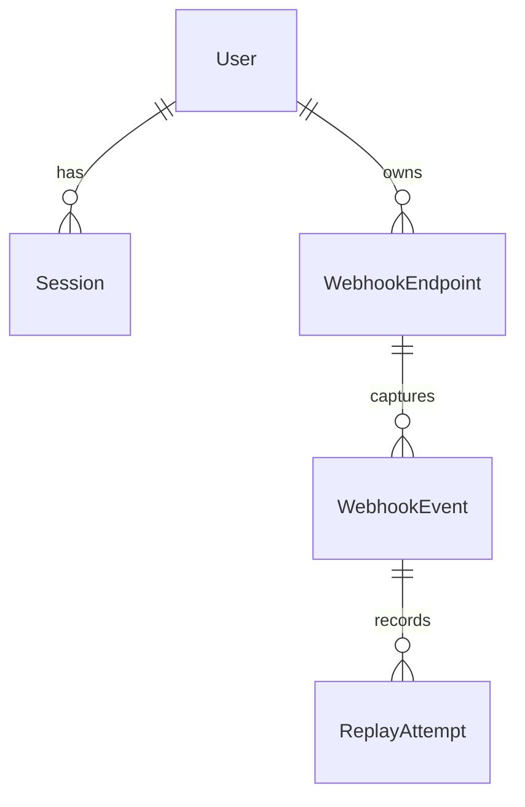

# Webhook Center domain model

## Proposed approach

Define the five core entities before choosing ORM syntax. First describe their
ownership and one-to-many relationships, then list the data each entity must
store. Finally, define deletion, retention and immutability rules and walk
through registration, capture, replay and endpoint deletion against the model.

## Entity relationship diagram

The notation `||--o{` means that one parent can have zero or many children,
while every child must have exactly one parent.

## Entities

The field lists are conceptual. They deliberately do not use Prisma or SQL
syntax.

### User

| Field          | Required | Rules and purpose                                                 |
| -------------- | -------- | ----------------------------------------------------------------- |
| `id`           | Yes      | Unique internal identifier. Never used as a public capture token. |
| `email`        | Yes      | Normalized and unique. Used to identify the account during login. |
| `passwordHash` | Yes      | One-way password hash. A plain-text password is never stored.     |
| `createdAt`    | Yes      | Account creation time.                                            |
| `updatedAt`    | Yes      | Time of the latest account change.                                |

### Session

| Field       | Required | Rules and purpose                                                            |
| ----------- | -------- | ---------------------------------------------------------------------------- |
| `id`        | Yes      | Unique internal identifier.                                                  |
| `userId`    | Yes      | References the one user who owns the session.                                |
| `tokenHash` | Yes      | Unique hash of the secret session token. The raw token is not stored.        |
| `createdAt` | Yes      | Session creation time.                                                       |
| `expiresAt` | Yes      | Time after which the session cannot be used. Must be later than `createdAt`. |
| `revokedAt` | No       | Logout or administrative revocation time. Once set, it is never cleared.     |

A session is active only when `revokedAt` is empty and `expiresAt` is in the
future.

### WebhookEndpoint

| Field          | Required | Rules and purpose                                                                              |
| -------------- | -------- | ---------------------------------------------------------------------------------------------- |
| `id`           | Yes      | Unique internal identifier used by database relationships.                                     |
| `userId`       | Yes      | References the one user who owns the endpoint.                                                 |
| `name`         | Yes      | Non-empty user-facing name, such as `Stripe test`.                                             |
| `captureToken` | Yes      | Unique, random and unguessable value used in the public capture URL. It is separate from `id`. |
| `createdAt`    | Yes      | Endpoint creation time.                                                                        |
| `updatedAt`    | Yes      | Time of the latest editable change, such as a name change.                                     |

Knowing a capture token permits sending a webhook, but it does not permit
reading the endpoint or its events. Protected operations still require the
endpoint owner.

### WebhookEvent

| Field           | Required | Rules and purpose                                                                  |
| --------------- | -------- | ---------------------------------------------------------------------------------- |
| `id`            | Yes      | Unique internal identifier.                                                        |
| `endpointId`    | Yes      | References the one endpoint that captured the request.                             |
| `method`        | Yes      | Original HTTP method.                                                              |
| `path`          | Yes      | Path on which the request was received.                                            |
| `rawQuery`      | Yes      | Original query string, including order and repeated parameters; empty when absent. |
| `headers`       | Yes      | Captured HTTP header names and values, including repeated values.                  |
| `rawBody`       | Yes      | Original request body as bytes; empty bytes represent an empty body.               |
| `bodySizeBytes` | Yes      | Size of the captured raw body. Must be zero or greater.                            |
| `receivedAt`    | Yes      | Time the request was captured.                                                     |

Parsed JSON, text or form representations are derived views. They never replace
`rawBody`, because parsing and serializing can change the original bytes.

### ReplayAttempt

| Field               | Required | Rules and purpose                                                                    |
| ------------------- | -------- | ------------------------------------------------------------------------------------ |
| `id`                | Yes      | Unique internal identifier.                                                          |
| `eventId`           | Yes      | References the one immutable event used as the replay source.                        |
| `targetUrl`         | Yes      | Absolute destination URL selected for this attempt.                                  |
| `status`            | Yes      | Lifecycle state: `pending`, `succeeded`, `http_error`, `timeout` or `network_error`. |
| `startedAt`         | Yes      | Time the replay started.                                                             |
| `completedAt`       | No       | Completion time. Empty only while the attempt is pending.                            |
| `httpStatusCode`    | No       | Response status when an HTTP response was received.                                  |
| `responseBody`      | No       | Safely capped response body captured for inspection.                                 |
| `responseTruncated` | Yes      | Indicates that the response exceeded the capture limit.                              |
| `durationMs`        | No       | Non-negative elapsed time. Set when the attempt finishes.                            |
| `errorMessage`      | No       | Safe diagnostic text for timeout or network failure; never includes secrets.         |

The replay request reuses the source event's method and exact `rawBody`. The
source event is never modified.

## Relationships and ownership

| Relationship                    | Cardinality         | Ownership rule                                              |
| ------------------------------- | ------------------- | ----------------------------------------------------------- |
| User to Session                 | One to zero-or-many | A session belongs to exactly one user and cannot be shared. |
| User to WebhookEndpoint         | One to zero-or-many | An endpoint belongs to exactly one user.                    |
| WebhookEndpoint to WebhookEvent | One to zero-or-many | An event belongs to exactly one endpoint.                   |
| WebhookEvent to ReplayAttempt   | One to zero-or-many | An attempt replays exactly one source event.                |

Ownership of protected records is resolved through their parents:

- a session is owned directly by `Session.userId`;
- an endpoint is owned directly by `WebhookEndpoint.userId`;
- an event is owned through `WebhookEvent -> WebhookEndpoint -> User`;
- a replay attempt is owned through
  `ReplayAttempt -> WebhookEvent -> WebhookEndpoint -> User`.

The API must follow this chain for every protected read, update, delete or
replay operation. A client-supplied identifier alone never proves ownership.

## Deletion and retention

- Deleting a user deletes all of that user's sessions and endpoints.
- Deleting an endpoint deletes its captured events. Deleting those events also
  deletes their replay attempts.
- Deleting one event deletes its replay attempts but does not delete its
  endpoint.
- Deleting a session or replay attempt never deletes its parent.
- Events and replay attempts have no automatic time-based deletion in the
  initial version. They remain until the user deletes an event, clears an
  endpoint history, deletes an endpoint or deletes the account.
- Revoked and expired sessions are retained for 30 days for basic audit and are
  then eligible for cleanup. Account deletion always removes them immediately.

These cascades prevent orphaned protected records and ensure that deleting an
endpoint also removes potentially sensitive captured payloads.

## Invariants

An invariant is a rule that must remain true for every valid record.

### WebhookEvent invariants

- A captured event always belongs to exactly one existing endpoint.
- All captured request fields are immutable after creation.
- `rawBody` contains the captured bytes, even when the body is empty or valid
  JSON.
- Parsed views never overwrite the raw request.
- Replaying or inspecting an event never changes it.

### ReplayAttempt invariants

- An attempt always belongs to exactly one existing event.
- Every attempt starts as `pending` and moves once to exactly one terminal
  status.
- A terminal attempt cannot return to `pending` or change its recorded result.
- `completedAt` and `durationMs` are present for every terminal attempt.
- `httpStatusCode` is present only when an HTTP response was received. A 4xx or
  5xx response is therefore different from a timeout or network failure.
- Response data is capped; `responseTruncated` records whether data was omitted.
- Creating an attempt never modifies the source event.

## Required walkthrough

### Registration and login

1. Registration creates one `User` with a unique normalized email and a
   password hash.
2. Login creates a `Session` owned by that user.
3. Logout sets `revokedAt`; the session can no longer be used.

### Webhook capture

1. The user creates a `WebhookEndpoint` with a unique random capture token.
2. An external service sends a request to the public URL containing that token.
3. The token resolves to exactly one endpoint.
4. The method, path, raw query, headers and raw body are saved once as an
   immutable `WebhookEvent` owned through that endpoint.

### Replay

1. An authenticated user selects an event.
2. The API follows the event-to-endpoint relationship and verifies that the
   endpoint belongs to the authenticated user.
3. The API creates one pending `ReplayAttempt` for that event.
4. The stored method and raw body are sent to the selected target.
5. The attempt moves to one terminal state and stores the safe, capped result.
   The source event remains unchanged.

### Endpoint deletion

1. The API verifies ownership of the endpoint.
2. Deleting the endpoint cascades to all of its events.
3. Deleting those events cascades to their replay attempts.
4. Other endpoints and all of their records remain unchanged.
